# illusion-rnn

A [neurogym](https://github.com/neurogym/neurogym)-based testbed for studying
**Transformational Apparent Motion (TAM)** in neural networks: task
environments, matched real-motion controls, a hand-made stimulus set, and
reference recurrent models — packaged so you can plug in your own model.

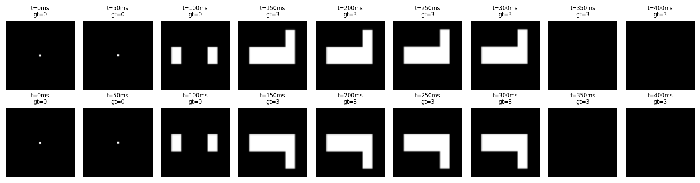

## What is TAM?

In transformational apparent motion, two *static* frames — two shapes, then
the same shapes joined by a bar — are perceived as a single object smoothly
transforming and moving in a definite direction. The percept requires solving
a shape-correspondence problem: which contours of frame 2 "came from" frame 1.
That makes TAM a compact probe of how visual systems infer motion from form.

This testbed frames TAM as a supervised trial task: networks are trained to
report motion direction (left / middle / right — or middle / up / down in the
vertical variant) either on TAM stimuli directly or on unambiguous frame-by-frame
motion controls, and are then tested on stimulus variants they never saw
(outline-only shapes, simplified layouts). The question: does motion inferred
from form transfer?

## Install

Requires Python ≥ 3.10. Checkpoints and the shapes dataset use git LFS.

```bash
git lfs install
git clone git@github.com:sh4r11f/illusion-rnn.git
cd illusion-rnn
uv sync            # or: pip install -e .
```

Library-only install (envs + models, no checkpoints):

```bash
pip install git+https://github.com/sh4r11f/illusion-rnn.git
```

## Quickstart

The snippet below assumes a full repo clone with git LFS (for the shipped
checkpoints); library-only installs (`pip install git+...`) can still build
environments and train models, but must download checkpoints separately.

```python
import illusion_rnn as ir

# a TAM environment (stimuli ship inside the package)
env = ir.make_env("tam", box_shape="square", variant="standard",
                  stim_ori="horizontal", img_size=64)
env.seed(0)
ir.plot_trials(env, n_trials=2)

# evaluate the shipped reference RNN on it
model = ir.load_rnn("checkpoints/rnn-pixel_h2048_tam-horiz.pt")
print(ir.evaluate(model, env, n_trials=100).accuracy)

# train your own
dataset = ir.make_dataset(env, batch_size=16, seq_len=100)
rnn = ir.RNNNet(input_size=64 * 64, hidden_size=256, output_size=6, dt=50)
history = ir.train(rnn, dataset, n_epochs=200)
```

See `notebooks/01_quickstart.ipynb` (tour + generalization result) and
`notebooks/02_train.ipynb` (training from scratch).

## The generalization result

The reference RNN — trained only on the *standard* TAM set — reaches 0.967
mean accuracy in-distribution (on `standard`, i.e. the training condition
itself), then drops to 0.100 mean accuracy on the genuinely held-out
`outline` variant (unseen at training time). That drop is not a story of
confidently wrong answers: the model abstains (reports "fixation" instead of
committing to a direction) on 77.7% of outline trials, and even restricted to
the trials where it does commit, accuracy is only 0.448 — better than the
0.33 chance rate, but far below in-distribution performance. In short, on
outline stimuli it mostly refuses to answer rather than answering wrong.

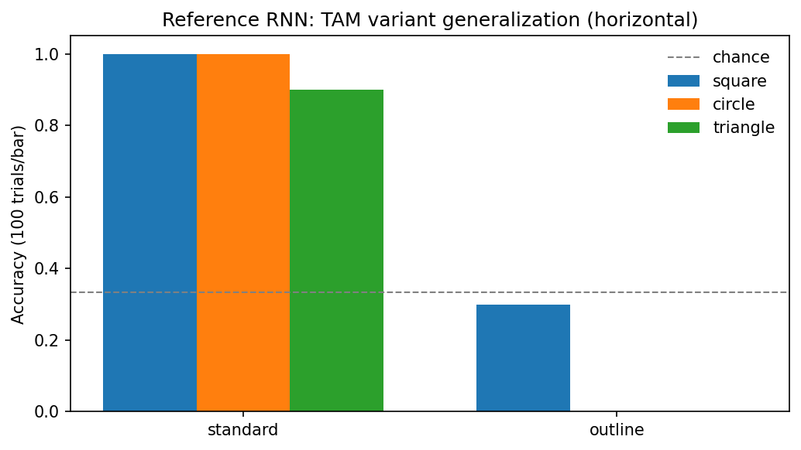

Exact numbers and every shipped model: [`checkpoints/MANIFEST.md`](checkpoints/MANIFEST.md).

Note: `TAM_basic`, a third stimulus directory shipped alongside `standard`
and `outline`, is **not** a held-out variant — all 24 of its images are
byte-identical to `TAM_task` images (21 share filenames, 3 are internal
duplicates; see `tests/test_stimuli_integrity.py`). Evaluating on it measures
performance on training data, not transfer, so it has been removed from the
comparison above.

## Analyses

`scripts/run_analyses.py` reproduces the project's dynamics and RSA analyses
(corrected reimplementations of the 2022–23 exploratory notebooks — see the
deviations documented in `illusion_rnn/analysis.py`): PCA of hidden-state
trajectories in the trained state space, time-binned PCA with top-loading
units, condition-averaged unit timecourses, unit-by-unit RDMs, and
second-order RSA within and across stimulus variants.

```bash
uv run python scripts/run_analyses.py   # writes results/*.npz (committed)
```

`notebooks/03_dynamics.ipynb` and `notebooks/04_rsa.ipynb` visualize the
committed artifacts. The cross-variant RSA asks the headline question —
is outline TAM represented like standard TAM? —

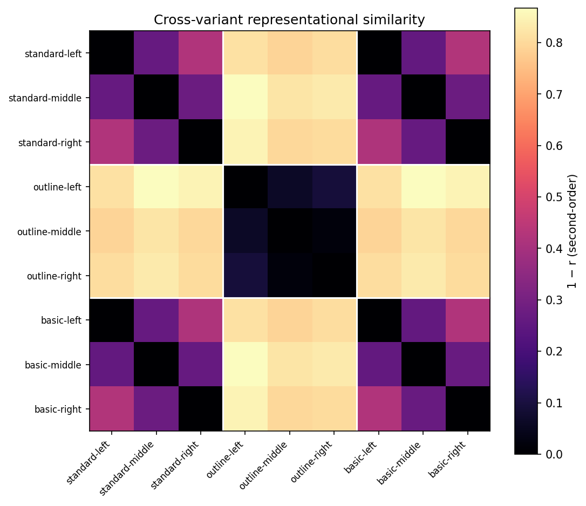

## The correspondence task

The 2023 result above cannot distinguish two very different hypotheses. In the
original stimulus set frame 1 is a single fixed image per shape, so the
direction label is fully determined by frame 2 alone — meaning "the network
infers motion from shape correspondence across time" and "the network
classifies one static image" predict the same 0.967. Nothing in that
experiment tells them apart.

`TAMCorrespondenceTask` (`illusion_rnn/envs.py`) is the corrected experiment.
Stimuli are generated programmatically (`illusion_rnn/generate.py`) rather than
drawn from ~22 hand-made JPGs, and the **bar's geometry is sampled before and
independently of the direction label**, so frame 2 is bit-identical whichever
direction the trial is. A model that sees only frame 2 is therefore at chance
*by construction*, not by hope.

Two stimulus families ship, and the contrast between them is the point:

- **`balanced`** — the corrected task described above.
- **`classic`** — the original 2023 geometry reproduced at scale, where frame 2
  *is* label-readable. It exists to quantify the defect, not to train on.

### Result

5 seeds × 6 architectures × 2 families, 64px, `hidden=256`
(`results/sweep.json`, mean accuracy on the training distribution with 95% CI):

| architecture | `balanced` (corrected) | `classic` (2023 geometry) |
|---|---|---|
| `RNNNet` | 1.000 [1.000, 1.000] | 1.000 [1.000, 1.000] |
| `GRUNet` | 1.000 [1.000, 1.000] | 1.000 [1.000, 1.000] |
| `FFStack` | 1.000 [1.000, 1.000] | 1.000 [1.000, 1.000] |
| `FF1Only` (frame 1 only) | 0.818 [0.805, 0.832] | 0.516 [0.489, 0.543] |
| **`FF2Only` (frame 2 only)** | **0.503 [0.472, 0.534]** | **1.000 [1.000, 1.000]** |

That bottom row is the whole argument. On the corrected stimuli a frame-2-only
model sits exactly at chance while binding models are perfect; on a faithful
reproduction of the 2023 geometry, frame 2 alone is *sufficient*. The original
0.967 is consistent with a network doing no temporal integration at all.

The `FF1Only` floor of 0.818 is **an artifact of our own position split**, not a
property of the task: the `train` split restricts bars to the lower 60% of the
track, and narrowing that band makes shape position more diagnostic of
direction. Bayes-optimal frame-1-only accuracy is 0.697 on the full track, 0.818
on `train`, and 0.942 on `test_position`. FF1Only is simply sitting at the
optimum for the band it trains on, so 0.82 — not 0.50 — is the bar a binding
model has to clear here.

### Two negative results

**Nothing generalizes across position.** On `test_position` (bars in the held-out
upper 40% of the track) *every* architecture collapses to chance — `RNNNet`
0.523, `GRUNet` 0.562, `FFStack` 0.407 — with zero abstention, so these are
committed wrong answers, not refusals. These are fully-connected models on
flattened pixels with no translation invariance, so this is expected, but it
means the models that score 1.000 are solving the task in a **position-locked**
way rather than learning an abstract correspondence rule. Held-out *shapes*
transfer fine (`RNNNet` 1.000 on `test_shape`); held-out *positions* do not.

**The frame-order control only works when each frame is shown once.** Shuffling
frame order should destroy the answer under `transform="growth+shrink"`, where
the same frame pair appears in both orders with opposite labels. It doesn't —
at the default `n_repeats=4`, `RNNNet-shuffled` still scores 0.999:

| | `RNNNet` | `RNNNet-shuffled` |
|---|---|---|
| `n_repeats=4` (default) | 1.000 | **0.999** — control is vacuous |
| `n_repeats=1` | 1.000 | **0.524** — control works |

The reason is repetition, not order: with frame 2 shown 4× and frame 1 once, the
shuffled multiset is `{f1, f2, f2, f2, f2}`, and a model recovers which frame
was which by **counting** rather than by position. Order is only genuinely
destroyed when each frame appears exactly once. Anyone building a
shuffle-based order control on a repeated-frame stimulus should check this.
(`results/sweep_order.json`, `results/sweep_order_n1.json`.)

### Outline transfer is a form effect, not an input-drive effect

The 2023 checkpoint scored 0.100 on outline stimuli, but a single number can't
say whether the network *can't infer motion from outline form* or whether the
outline input is simply too faint to drive it at all. Evaluating one
filled-trained `RNNNet` across stroke widths, under both raw and
ink-energy-matched rendering, separates them:

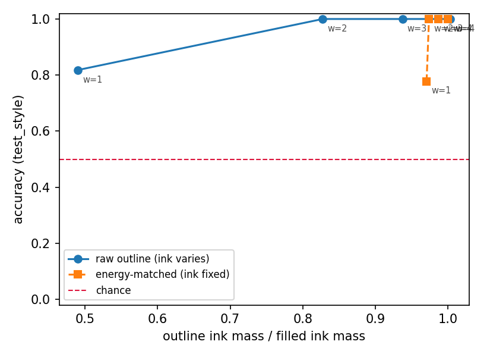

| stroke width | raw ink ratio → acc | energy-matched ink ratio → acc |
|---|---|---|
| 1 | 0.490 → **0.818** | 0.970 → **0.778** |
| 2 | 0.827 → 1.000 | 0.974 → 1.000 |
| 3 | 0.937 → 1.000 | 0.987 → 1.000 |
| 4 | 1.003 → 1.000 | 1.000 → 1.000 |

At width 1, restoring the missing ink (0.490 → 0.970) does **not** restore
accuracy (0.818 → 0.778). The thin-stroke deficit is therefore about outline
*form*, not about input drive — energy-matching doesn't rescue it. At widths ≥ 2
the filled-trained model transfers to outline at ceiling, so on this corrected
task outline transfer largely succeeds, in contrast to the 2023 checkpoint's
near-total outline failure.

### Reproducing

```bash
uv run python scripts/verify_generator.py    # checkpoint 1: frame-2 label independence
uv run python scripts/verify_baselines.py    # checkpoint 2: baselines land at their ceilings
uv run python scripts/run_sweep.py --quick   # a fast local grid
uv run python scripts/run_order_control.py                 # order control (n_repeats=4)
uv run python scripts/run_order_control.py --n-repeats 1   # ... and the condition where it works
```

Full results, the three unplanned findings, and notes on what this does and
does not show: [`docs/findings/2026-08-25-correspondence-results.md`](docs/findings/2026-08-25-correspondence-results.md).

The full grid was run on Hugging Face Jobs (`scripts/hf_sweep.py`, ~1h on one
L4). `uv run pytest -m slow` runs the two training-based gate tests, which are
excluded from the default suite.

## Classical apparent motion as imputation

`illusion_rnn/apparent.py` adds a second, self-supervised paradigm. A shape
translates at constant velocity from point a to point b over 8 frames. The
network sees the movie with some frames blanked and is trained to reconstruct
the **whole** movie. The test is the limiting case: only the two endpoint
frames are shown, which is the classical apparent-motion display. The question
is whether the reconstruction of the blanked frames contains the intermediate
positions.

```python
import illusion_rnn as ir

model = ir.ImputationNet(input_size=32 * 32, hidden_size=512, n_frames=8)
ir.train_imputation(model, n_steps=20_000, max_gap=4, img_size=32)
print(ir.evaluate_imputation(model, "apparent", img_size=32))
```

Design choices that the result depends on:

- **Readout after the sequence.** `readout="final"` decodes all frames from the
  hidden state after the last frame, so a blanked frame can be reconstructed
  using the endpoint that came after it. `readout="online"` decodes each frame
  at its own timestep and can only extrapolate; it is the comparison.
- **The test is out of the training distribution.** `max_gap` caps the run of
  consecutive blanked frames in training (4 here); the apparent-motion test
  blanks 6. A second model trained with unbounded gaps shows what the same
  architecture reaches when the test condition is trained on.
- **No memorizable trajectory.** Start point, direction (any angle), distance
  (25-75% of the canvas), shape and size are all sampled per trial; 10% of
  trials are stationary.
- **Not a neurogym env.** The target is a movie, not a class label per
  timestep, so batches are sampled directly.

### Result

CTRNN, `hidden=512`, 32px, 20,000 steps, 3 seeds, 500 test trials each
(`results/apparent_motion.json`; means over seeds):

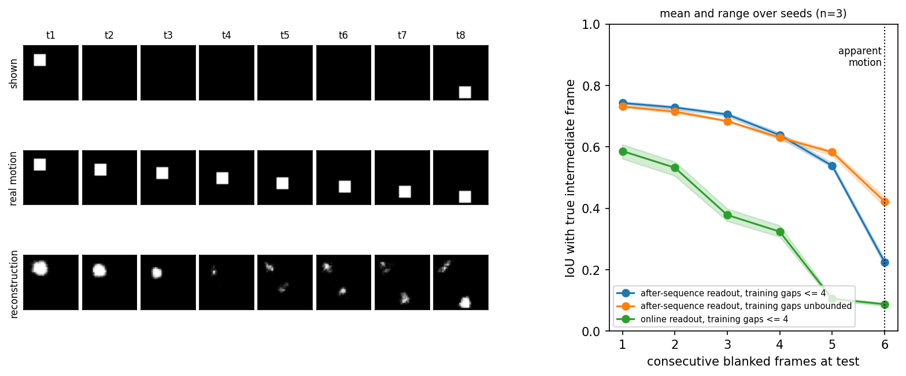

| blanked frames at test | IoU with true frame | centroid error (px) | ink drawn / true ink |
|---|---|---|---|
| 1 (trained) | 0.743 | 0.45 | 1.02 |
| 4 (trained, longest) | 0.638 | 0.63 | 0.98 |
| 5 (never trained) | 0.539 | 0.85 | 0.86 |
| **6 = apparent motion (never trained)** | **0.225** | **2.25** | **0.46** |
| 6, model trained with unbounded gaps | 0.422 | 1.36 | 0.93 |
| 6, online readout | 0.087 | 4.95 | 1.03 |

Fill-in on apparent motion is **partial**. The ink the network draws in the
blanked frames does travel from a to b (regression slope of the reconstructed
centroid along the a-b axis against the true position: 1.06; mean a-b distance
is about 16 px, centroid error 2.3 px), and the reconstruction overlaps the
true intermediate frame more than it overlaps the nearest endpoint (0.225 vs
0.182) or both endpoints superimposed (0.102). But it draws less than half of
the ink, and individual reconstructions are fragmented rather than one clean
moving shape (see the bottom row of the figure). Performance degrades smoothly
up to 5 blanked frames and drops sharply at 6.

### Position, not pixels

IoU punishes wrong shape and missing ink even when the ink is in the right
place. `patch_position_metrics` scores position only: in each blanked frame it
discards ink inside the start-frame footprint (ink merely held at a does not
count), takes the largest remaining connected patch, and measures the distance
from its centre to where the shape would actually have been. Apparent-motion
test, means over 3 seeds; mean a-b distance is about 16 px:

| | patch found | centre error (px) | if the patch sat at the nearer endpoint |
|---|---|---|---|
| training gaps <= 4 (test never trained) | 55% of frames | 1.68 | 3.64 |
| training gaps unbounded | 86% | 1.45 | 3.96 |
| online readout | 48% | 4.36 | 4.17 |
| true movie scored the same way | 100% | 0.66 | |

In the two middle frames (t4, t5), where a jump to either endpoint is 5.4 px
off, the patch is 1.7 and 1.5 px off. So when the network draws something away
from the start, it draws it at the interpolated position, not at an endpoint
-- but in the never-trained condition it draws such a patch in only about half
of the blanked frames. The error is conditional on a patch being found, and
the 0.66 px floor is the bias of discarding the start footprint (it clips the
true shape in the first frames after a). The numbers are stable across
detection thresholds 0.1-0.5 (error 1.85-1.48 px, patch found 71%-39%).

The online readout fails at long gaps as it must (5 px error, slope 0.48): it
has not seen b when it has to draw the intermediate frames.

Limitations: reconstruction is imperfect even in the trained regime (IoU 0.74
with one blanked frame), so these fully-connected pixel models are a floor, not
a tuned result. The same-place flicker control (`"flicker"`: endpoints only,
a = b) is reconstructed in place but faintly (IoU 0.46, ink ratio 0.71), so
part of the apparent-motion deficit is a deficit for *any* two-frame display,
not for motion specifically. Longer inter-stimulus intervals and held-out
positions or speeds are not tested, and there is no human anchor.

```bash
uv run python scripts/run_apparent_motion.py --quick   # smoke run
uv run python scripts/run_apparent_motion.py           # ~1h on 8 CPU cores
```

### Can position be read out when no patch is drawn?

Yes, in this task. With both flashes shown, a linear readout of the **frozen
final hidden state** predicts the six missing (x, y) ink centroids. Across
three gap-limited CTRNN checkpoints, mean error is **2.06 px on frames without
a detected patch** and **2.10 px on frames with one**. Detection uses the same
threshold and start-footprint exclusion as above; “no patch” does not mean
zero ink.

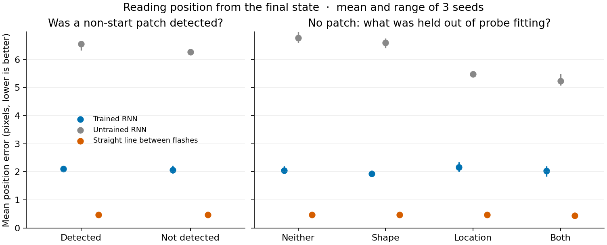

Each row below is restricted to blank frames **without** a detected patch.
The two probes are fitted identically and scored on exactly the same frames
within each seed; only the RNN weights differ.

| Held out of probe fitting | Trained state: mean error (px) | Untrained state (px) | Trained state within 2 px |
|---|---:|---:|---:|
| Neither | 2.05 | 6.77 | 60% |
| Shape (cross) | 1.93 | 6.59 | 62% |
| Location (central tile) | 2.17 | 5.48 | 52% |
| Both | 2.04 | 5.23 | 56% |

**Protocol.** Fit one affine ridge readout per checkpoint (12 outputs; activity
standardized on fitting trials only, fixed penalty 1). The 4,096 fitting
movies use squares, circles and triangles; no frame's centroid enters the
central tile (both coordinates in `[11, 21)` on the 32 px canvas). The 2,048
fresh test movies include crosses. No pair of endpoint images repeats, and
the same test movies are used for every seed. Test frames are grouped by
their true centroid; different frames of one movie can fall in different
location groups. The cross is new to **both** the probe and recurrent network;
the location is held out of the **probe only**.

**What the result supports.** Across *all* blank frames, the hidden-state
readout lands within 2 px on 57%; the rendered patch does so on 40%, counting
missing patches as misses. Training makes position more accessible to a
linear readout than it is in the same network at random initialization.
It does **not** establish that the RNN internally simulates a moving shape:
storing both endpoints would suffice. Straight-line interpolation of the two
visible ink centroids has only 0.47 px mean error (the movie is rasterized).

```bash
uv run python scripts/run_apparent_motion.py --save-dir checkpoints/apparent
OPENBLAS_NUM_THREADS=2 uv run python scripts/run_position_probe.py --checkpoints checkpoints/apparent
```

The latter command does not train the RNN. It writes the figure and
`results/position_probe.json`, with per-seed frame counts, distances and rates
for all, detected and undetected frames, including the per-timepoint mean
(no-input) and straight-line controls.

### Acceleration versus path: can a third flash distinguish the alternatives?

For each pair of endpoints, generate **nine** movies of the same shape over the
same eight frames: steady motion, speeding up, or slowing down, each along a
straight line or a 120° circular arc bending left or right. Normalized distance
along the path at normalized time `t` is `t`, `t²`, or `2t − t²`. This varies
**tangential acceleration**, not just the endpoint distance. The arcs are longer
than the straight chord, so mean speed is matched across timing profiles *within*
each path, not across path shapes. Only after constructing a trajectory do we
round to pixels.

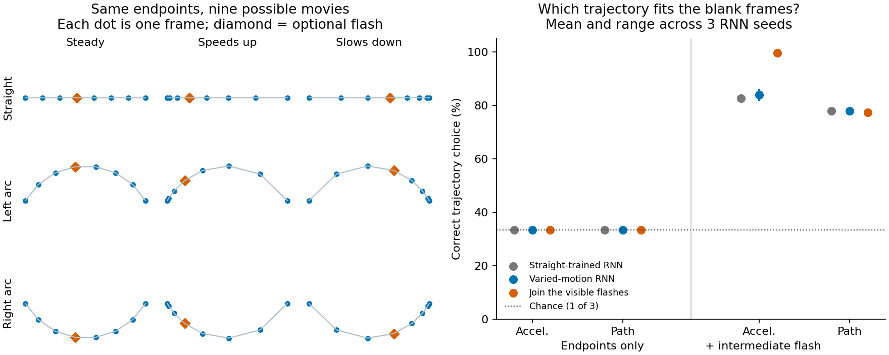

The three original gap-limited CTRNNs received 2,000 additional pixel-imputation
training steps each on randomly masked examples of all nine combinations (maximum
training gap four). At test we either show frames 1 and 8, or also show frame 4.
**Both conditions are scored on the same five hidden frames**, never the cue.
One ridge readout per frozen RNN predicts all five positions from its final
state; it is fitted on 4,096 other movies in both cue conditions, excluding test
endpoint pairs. The test crosses all nine variants with the same 192 endpoint
pairs and uses identical stimuli across network seeds.

| Readout / display | Acceleration choice | Path choice | Position error (px) |
|---|---:|---:|---:|
| Adapted RNN, endpoints only | 33% | 33% | 3.35 |
| Original straight-trained RNN, endpoints + cue | 82% | 78% | 1.86 |
| Adapted RNN, endpoints + cue | 84% | 78% | 1.85 |
| Straight lines between visible flashes, with cue | 99.6% | 77% | 1.21 |

For each choice, score the candidate whose blank-frame positions are closest on
average to the readout. The **other factor is held fixed** (three candidates,
fractional credit for ties); these are not nine-way classification accuracies.
Chance with endpoints only is a consequence of identical inputs, not a model
failure. Both networks retain information about the cue; adaptation changes
linear decodability little. With the cue, the *rendered patch* lands within
2 px on 62% of blank frames before adaptation and 72% after (non-detections
count as misses); without it, the adapted network scores 15%. The network
uses intermediate evidence, but the simple
piecewise-linear baseline has lower position error; this is not evidence for
an internal acceleration law.

```bash
# Starting checkpoints: use run_apparent_motion.py --save-dir as above.
uv run python scripts/run_trajectory_experiment.py adapt --base checkpoints/apparent --checkpoints checkpoints/trajectory
OPENBLAS_NUM_THREADS=2 uv run python scripts/run_trajectory_experiment.py evaluate --checkpoints checkpoints/trajectory --base checkpoints/apparent
```

The evaluation writes `results/trajectory_experiment.json` (including the 3×3
error breakdown for each seed) and the figure. `evaluate --base` also probes
the original networks **before** adaptation on the same movies with freshly
fitted readouts.

### Forecasting acceleration without seeing the endpoint

Show frames 1–4, then four blanks: no endpoint or intermediate cue. The
**last two visible images are pixel-identical** for the speeding-up, steady,
and slowing-down members of each matched set on a given path. Earlier frames
carry the acceleration evidence. Continuing the last measured displacement
must therefore give the *same* forecast for all three, while correctly
continuing the acceleration must separate their future positions.

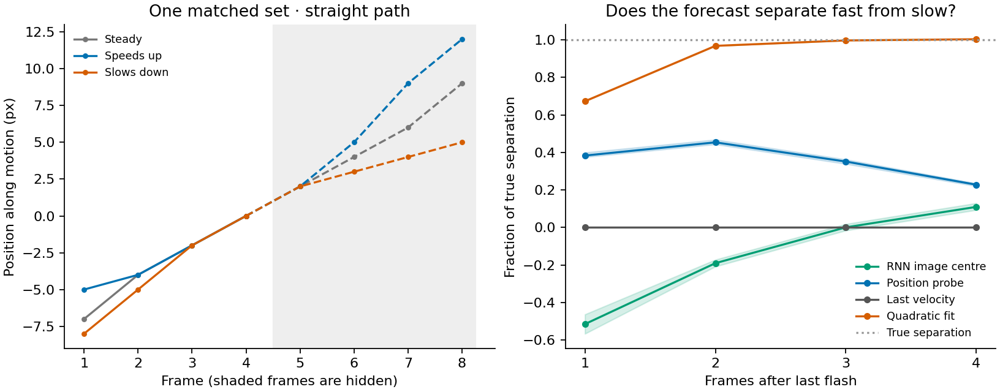

At the **fourth hidden frame on straight paths**, the frozen, varied-motion
RNN shows little of the true separation:

| Forecast | True fast–slow separation recovered | Mean position error (px) |
|---|---:|---:|
| Continue last observed velocity | 0% | 3.68 |
| RNN's rendered ink centre (all frames) | 11% | 4.15 |
| Largest non-start patch (when detected) | 19% | 4.77 |
| Linear position probe on the RNN state | 23% | 5.47 |
| Same probe on an untrained RNN | 9% | 7.61 |
| Quadratic fit to the four visible centroids | 100% | 4.98 |

For separation, project the predicted speed-up/slow-down difference onto the
true difference, summed across matched pairs and normalized by the summed
squared true separation. A gain of 1 means the correct *average contrast*,
not accurate individual forecasts: pixel rounding makes the quadratic fit
noisy. On the two non-steady straight conditions, the endpoint ink centre is
closer to the last-velocity forecast than to the true endpoint 67% of the
time (ties split). Mean error includes all three timing profiles. Patch error is conditional
on detection (78% of movies); patch separation requires both detections (71%
of pairs). On left and right arcs, the rendered ink centre also recovers only
about 11% of the final separation. These are weak responses to motion history,
not evidence that the RNN faithfully applies either kinematic law.

**Protocol.** Test the same three adapted RNNs without retraining them. In
each of 256 test groups, all nine movies share the object and position at the
last flash. The last arclength step `v` and path geometry are shared within
each acceleration comparison; successive steps change by 0 or ±16–23% of `v`
per frame, never reversing. The renderer fits all alternatives jointly on the
canvas. Only the first four images enter the model; its usual after-sequence
decoder reads the final state after the blanks. The separate ridge probes
learn from 512 other nine-movie groups, excluding any last-two-flash image
pair in the test set. A probe can learn a forecasting rule from labels; the
unmodified pixel decoder does not get those labels.

```bash
OPENBLAS_NUM_THREADS=2 uv run python scripts/run_prefix_forecast.py --checkpoints checkpoints/trajectory
```

The runner writes `results/prefix_forecast.json` with per-horizon results for
each path, timing profile and seed, and `figures/prefix_forecast.png`.

### Does the endpoint result transfer across objects and sizes?

Change only the object: a filled square, a filled cross or a one-pixel hollow
square, each 3, 7 or 11 pixels wide. The same 192 groups of **ink-centre
tracks** are replayed in all nine conditions within each task. Placements fit
the largest object on the 32 px canvas; no clipping or size-dependent slowing
is needed. Training used filled squares, circles and triangles, 4–8 px wide.
Only the 7 px filled square is familiar on both dimensions. Intensity per ink
pixel, not total ink, is held fixed.

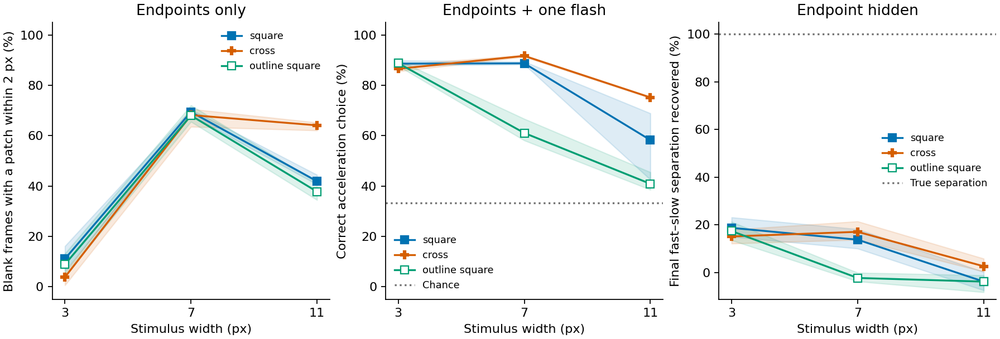

Means over three model seeds; the bands in the plot are their ranges.

| Stimulus | Width (px) | Patch found / within 2 px¹ | Cued acceleration / path choice² | Fast–slow separation recovered³ | Forecast error³ (px) |
|---|---:|---:|---:|---:|---:|
| Filled square | 3 | 15% / 11% | 89% / 84% | 19% | 3.54 |
| Filled square | 7 | 86% / 69% | 89% / 82% | 14% | 3.41 |
| Filled square | 11 | 93% / 42% | 58% / 58% | −4% | 3.76 |
| Cross | 3 | 5% / 4% | 87% / 80% | 15% | 3.61 |
| Cross | 7 | 88% / 68% | 92% / 85% | 17% | 3.38 |
| Cross | 11 | 100% / 64% | 75% / 70% | 3% | 3.61 |
| Hollow square | 3 | 12% / 9% | 89% / 83% | 17% | 3.54 |
| Hollow square | 7 | 96% / 68% | 61% / 51% | −2% | 3.91 |
| Hollow square | 11 | 100% / 38% | 41% / 38% | −4% | 5.01 |

1. **Straight, constant-speed fill-in:** the original gap-limited RNN sees
   only the endpoints. Both percentages use *all six blank frames*; no
   detected non-start patch counts as a miss. Conditional on a detection, the
   patch is closer on average to the true position than the nearer endpoint
   for every stimulus and size. That does not make the tiny objects reliable:
   the network rarely draws a detectable second patch for them. At large sizes
   removing the initial footprint also clips more of the true object.
2. **Interpolation with a cue:** the varied-motion RNN sees the endpoints
   and optionally frame 4. Without frame 4 every condition scores 1/3 on
   each choice by construction. With it, both choices improve, but transfer
   depends on appearance. At 11 px the hollow square is barely above chance
   on path. Choice ranks three trajectories with the other factor held fixed;
   it does **not** guarantee a precise position. For the 11 px filled square
   one seed’s cued probe has 48.65 px mean error (the others: 3.15 and 3.00).
   Coordinates from the linear probe are not clipped to the canvas.
3. **Endpoint-free forecast:** the varied-motion RNN sees frames 1–4 and
   then four blanks. The table scores its unmodified image decoder’s ink
   centre at the final blank on straight paths. A gain of 100% reproduces the
   true separation, 0% ignores acceleration, and negative values have the
   fast–slow contrast slightly reversed on average. Weak separation transfers
   to all nine conditions. The *error ranking* does not: continuing at the
   last velocity scores 3.69 px for every appearance (identical tracks), and
   the RNN has lower mean error in six conditions. Low position error by
   itself is not evidence for acceleration forecasting.

**No retraining per condition.** For each adapted RNN, fit one interpolation
probe and one forecast probe on separate, familiar movies, excluding all
matching test endpoint or last-visible image pairs, respectively. Apply the
same two probes across all nine conditions. The results include per-seed
records, the visible-line, velocity and quadratic controls, and separate
left/right-arc forecast scores. For example, the RNN beats the velocity
baseline by 0.31 px on the 7 px cross (95% paired bootstrap interval:
0.18–0.44 px), but is worse by 1.32 px on the 11 px hollow square
(1.15–1.50 px). These intervals resample the 192 trajectory groups after
averaging over the three fixed networks; they do not estimate uncertainty
over new training runs or adjust for testing multiple conditions.

```bash
OPENBLAS_NUM_THREADS=2 uv run python scripts/run_stimulus_robustness.py \
    --base checkpoints/apparent --checkpoints checkpoints/trajectory
```

Full results: [`results/stimulus_robustness.json`](results/stimulus_robustness.json).

### JEPA: predict where the object is without predicting its pixels

We trained a small **joint-embedding predictive architecture (JEPA)** from
scratch on the same motion task. Given both endpoints and an intermediate
flash, its predicted embeddings distinguish speeding up from slowing down or
moving steadily. Without an endpoint, they do **not** reliably continue the
acceleration. On these movies, predicting embeddings was not better than
predicting pixels with a comparable model.

| Model and position readout | Cued acceleration / path choice | Cued position error (px) | Final fast–slow separation without endpoint | Final position error (px) |
|---|---:|---:|---:|---:|
| JEPA, predicted embedding → single-image position | 79% / 77% | 2.27 | −6% | 4.01 |
| Matched pixel control, centre of predicted ink | 98% / 93% | 1.17 | 6% | 3.77 |
| JEPA, probe fitted on motion labels | 82% / 76% | 2.12 | 8% | 5.25 |
| Matched pixel control, same probe protocol | 96% / 90% | 1.33 | 26% | 5.36 |
| Earlier CTRNN, same probe protocol | 76% / 70% | 4.42 | 12% | 6.68 |
| Join visible flashes / continue last velocity | 99.7% / 78% | 1.23 | 0% | 3.69 |

Means weight the nine shape–size conditions and three training seeds equally,
using the **same test tracks** as the preceding experiment (192 groups per
task). Interpolation scores five hidden frames across all paths; forecast
columns score the fourth hidden frame on straight paths. With endpoints only,
acceleration and path choice are both 1/3 because the alternatives have
identical inputs. On the straight, steady subset the JEPA's single-image
readout has 3.56 px error without the cue; simply joining the endpoints
scores 0.47 px. A negative separation is a small reversal of the fast–slow
contrast, **not** a negative distance. The CTRNN is a reference, not the
matched control: it has a different architecture and a longer training run.

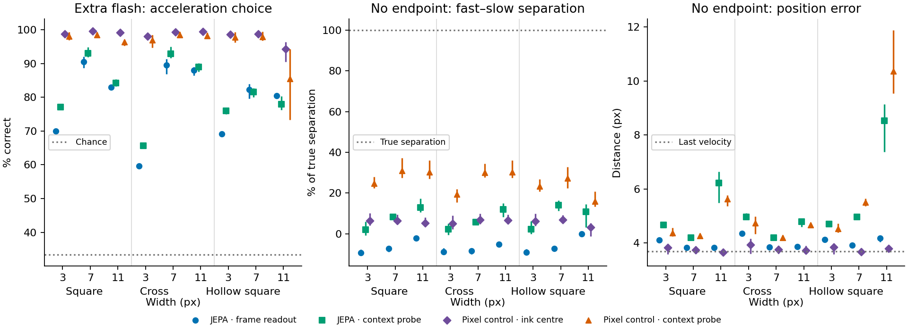

**What the two JEPA readouts measure.** The first is one affine map from a
teacher embedding of an individual image to its ink centroid, fitted on
familiar shapes. Apply it unchanged to each *predicted* embedding: it never
trains on forecasts. On fresh familiar images where the object is actually
shown it scores 1.46 px. In contrast, the context probes learn the five
missing or four future coordinates directly from frozen context, using the
same familiar fit movies, excluded test pairs and ridge protocol as the CTRNN.
A probe may learn a forecasting rule; it need not reflect what the model
predicts on its own.

**Training.** An average-pooled frame MLP produces 48 features. A temporal
MLP reads the ordered visible slots and visibility flags and predicts an
embedding per frame. The target encoder sees **each true frame independently**,
has no gradient, and follows the online frame encoder by exponential moving
average (decay 0.99). Training minimizes masked-frame embedding MSE plus
variance and covariance penalties on visible features. This is a task-sized
JEPA, not pretrained V-JEPA. The control keeps the same online backbone,
initialization, movies, masks and optimizer schedule but uses a pixel head
and masked-frame BCE instead. Both get 1,000 straight-motion and 2,000
varied-motion updates, batch size 32, maximum training gap 4; no coordinate
labels are used to train either backbone.

**Collapse check.** On 512 held-out familiar movies, the teacher has a
participation rank of 31–32 out of 48 dimensions across seeds. Cued hidden
embeddings match the correct frame better than the same time in an unrelated
movie (MSE 0.43 vs 1.00); the prefix-only comparison is 0.59 vs 0.89.
These checks show nonconstant, informative predictions, not a learned law of motion.

```bash
uv run python scripts/train_motion_jepa.py --checkpoints checkpoints/jepa
OPENBLAS_NUM_THREADS=2 uv run python scripts/evaluate_motion_jepa.py --checkpoints checkpoints/jepa
```

[Per-seed results](results/motion_jepa.json) include all forecast horizons and paths.

### Head to head on the original two-flash task

Here the object moves **in a straight line at constant speed**. Both frozen
models see only frames 1 and 8 of exactly the same 2,048 moving movies
(squares, circles and triangles, 4–8 px). Neither sees the six target images.
The comparison uses the original gap-limited CTRNN, not the same-backbone
pixel control, and the final JEPA from the preceding experiment.

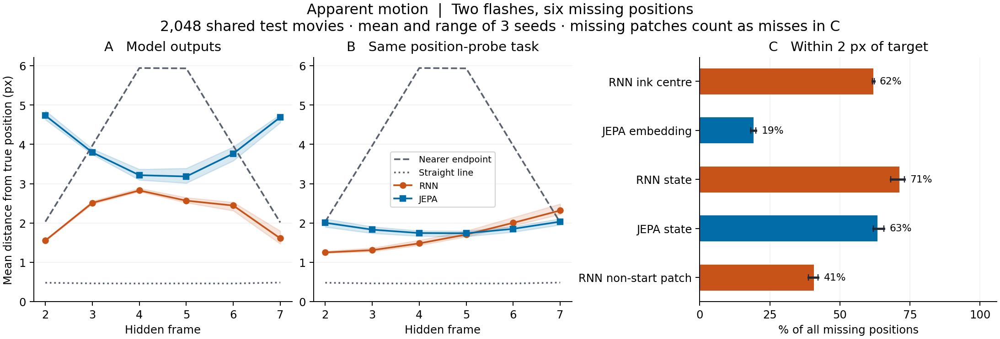

| How position is measured | Original RNN | JEPA |
|---|---:|---:|
| Model output: mean error | 2.25 px | 3.90 px |
| Model output: fraction within 2 px | 62% | 19% |
| Matched context probe: mean error | 1.68 px | 1.87 px |
| Matched context probe: fraction within 2 px | 71% | 63% |

**The readout matters.** Panel A scores the centre of all the RNN’s drawn
ink and a single-image coordinate readout of the JEPA’s predicted frame
embedding. Those are different output mechanisms. Panel B instead fits each
model the same affine ridge task: recover all six positions from the RNN’s
final state or JEPA’s context. The mean error gap shrinks from 1.65 px to
0.19 px (paired 95% movie-bootstrap intervals: 1.56–1.73 and 0.16–0.22 px,
conditional on these three seeds). Panel C includes every missing frame.
In particular, an RNN non-start patch is detected on 57% and lands within
2 px on 41%; the centre of *all* ink need not coincide with a distinct patch.
Joining the visible centres already achieves 0.47 px error, versus 3.98 px
for the nearer endpoint. Neither learned system beats that straight-line rule.

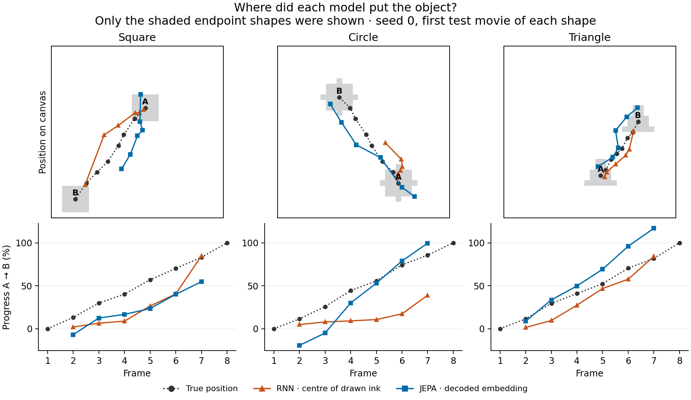

The second plot uses the **first test movie of each shape**, not a model’s best
trial. A and B are the flashes. The top row shows both spatial dimensions;
the bottom projects position onto the A–B direction (0% = start, 100% = end).
Only the six hidden estimates are plotted for the models. Connecting them
illustrates the after-sequence reconstruction; it is not a trace recorded
online as the frames went by.

**Protocol.** No backbone retraining. Use 4,096 separate fitting movies from
the same familiar shape and location distribution, with no repeated endpoint
image pairs within or between splits. Fit the JEPA image-to-position
calibration on *individual visible fit flashes* and their own coordinates.
Fit both context probes on the same hidden position labels. Shading and
whiskers span the three checkpoint seeds. The RNN had 20,000 straight-motion
updates; the JEPA had 1,000 straight and 2,000 varied updates. This measures
these checkpoints’ performance, not a training-budget-controlled advantage.

```bash
OPENBLAS_NUM_THREADS=2 uv run python scripts/compare_main_task.py \
    --rnn checkpoints/apparent --jepa checkpoints/jepa
```

[Per-frame measurements and example coordinates](results/main_task_comparison.json).

### Does an internal position signal actually move the output?

A probe can find information that the model itself never uses. Here we
**change the activations inside the frozen network**, run its remaining
layers, and measure whether its six missing-position estimates move.
Each test pair has the same object, size and unchanged flash; only A *or*
B moves 4 pixels left, right, up or down. The intact response is the model’s
output on the moved movie minus its output on the original. It is not the
ground-truth motion: averaged over the six blank frames, shifting just one
endpoint ideally shifts a straight interpolant by 2 px.

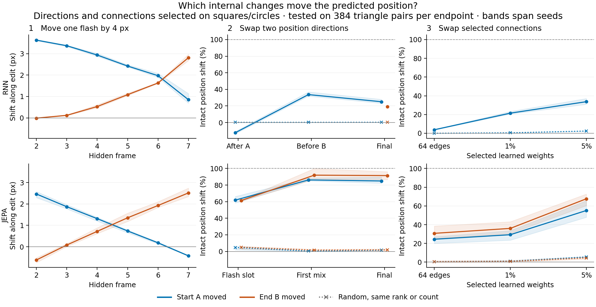

**Finding the signal.** On 1,024 square/circle pairs per endpoint, regress
the change in activation on the signed x/y translation, separately at each
site. These two directions use no decoder weights. On 384 new triangle
pairs per endpoint, copy *only* the donor-minus-original change in that
plane into the original state. For the reverse test, leave the donor
intact except for restoring that plane to its original value. Score the
RNN’s ink centre or the JEPA embedding through a fixed position calibration
fit only to individual square/circle flashes. No target movie or hidden-frame
coordinates enter the networks. The triangle is held out of this analysis,
not of backbone training.

| Final-state intervention (mean across three seeds) | RNN: A / B | JEPA: A / B |
|---|---:|---:|
| Moving the real flash: mean signed output shift | 2.53 / 1.03 px | 1.03 / 1.00 px |
| Copying just the position plane: % of intact shift | 25 / 19% | 85 / 91% |
| Blocking just that plane: % of intact shift removed | 26 / 23% | 85 / 91% |
| Copying that plane: reduction in per-example coordinate RMSE to donor | 12 / 7% | 28 / 24% |

At initialization the intact models barely shift in the requested direction
(absolute seed-mean below 0.02 px for each endpoint, with calibration refit
for each untrained JEPA). Random two-dimensional planes in the *trained*
models recover at most 2% of the mean shift on average at the final state.
**These percentages are not position accuracy.**
The JEPA’s *mean signed response* is concentrated in two directions even
though swapping them reduces the discrepancy from the donor’s full predicted
embedding by only about 3% (L2 norm across trials/frames). Its final
predictor and calibration are affine, so the final copy/block tests are
algebraic complements, not independent confirmations. Upstream swaps in the
flash slot and first mixing layer also change the output. In the RNN,
swapping the start-position plane **before B arrives** reproduces 34% of the
start effect. Immediately after A, the same procedure gives a small effect
in the *opposite* direction: a single fixed interpretation across recurrent
steps is not supported.

**Finding connections.** Test the JEPA’s moved flash slot → first context
layer and the RNN’s last blank state → final learned recurrent update. The
RNN’s direct leaky-memory path remains intact; because the last blank state
cannot know B, we test only the A route there. On fit pairs, rank weights by
the absolute mean signed contribution to output movement (upstream activation
change × weight × downstream gradient, evaluated at the midpoint before the
nonlinearity). Ranking proposes a circuit; the **test** swaps contributions
on individual edges and reruns the actual nonlinear network on new triangles.
No weights are retrained or zeroed.

| Tested route | Top 5% swapped: shift recovered | Random 5% swapped | Top 5% blocked: shift removed |
|---|---:|---:|---:|
| RNN start, across final recurrent update | 34% | 2% | 37% |
| JEPA start slot → first context layer | 55% | 6% | 55% |
| JEPA end slot → first context layer | 68% | 4% | 67% |

The denominator is the **intact model’s** mean signed shift, not just that
layer’s effect. “5%” is of the tested matrix, not of the model: 13,107 of
512 × 512 recurrent edges or 461 of 48 × 192 slot edges. Four independently
matched random sets are averaged within each seed. RNN transfer still occurs
through the direct leak when the learned recurrent route is blocked. These
are **partial, task-specific routes** for where the flashes were, not unique
position neurons or evidence of a trajectory simulator. A stronger next
test would keep the endpoints fixed and move an intermediate cue: do the
same edges change the reconstructed *path* without changing the endpoints?

```bash
OPENBLAS_NUM_THREADS=2 uv run python scripts/trace_position.py \
    --rnn checkpoints/apparent --jepa checkpoints/jepa
uv run python scripts/plot_position_trace.py
```

[Per-seed interventions, controls and top-64 edge identities](results/position_trace.json).
Unit identities are local to each seed. Native-output and coordinate recovery
are one minus patched-to-donor RMSE divided by original-to-donor RMSE; they
can be negative. The result file also includes tests of 8 × 8 unit blocks
and matched untrained models (use absolute shifts, not ratios near zero).

## Plug in your own model

`ir.train` / `ir.evaluate` accept any callable module with the contract
`model(x: (T, B, F)) -> (out: (T, B, n_actions), activity: (T, B, H))`.
Two input regimes:

- **Raw pixels** (default): frames are flattened to `F = img_size²`.
- **Feature encoder**: pass `encoder=ir.cnn_encoder(your_cnn)` where the CNN
  maps `(N, 1, H, W) -> (logits, features)`; the RNN then sees `F =
  feature_dim`. The shipped `rnn-cnnfeat64_*` checkpoints use the packaged
  `ShapesCNN` this way (100×100 inputs — see the manifest).

Custom stimuli: give the loaders a directory of your own JPGs
(`ir.load_tam(64, source="path/to/frames")`) following the filename
conventions in `illusion_rnn/stimuli.py`, and pass the result to the env via
`stimuli=`.

## Layout

```
illusion_rnn/       the package: envs, stimulus loaders, models, train/eval, plotting
  generate.py       programmatic stimulus generator + train/test splits
  apparent.py       classical apparent motion as masked-frame imputation
  sweep.py          multi-seed architecture grid runner
checkpoints/        trained models (git LFS) + MANIFEST.md
notebooks/          01_quickstart, 02_train, 03_dynamics, 04_rsa; legacy/ holds
                    the 2022-23 research record
scripts/            verification checkpoints, sweeps, figures, CNN retraining
results/            committed analysis + sweep artifacts (*.npz, *.json)
data/shape_dataset/ training data for that CNN (git LFS, 90 MB)
tests/              pytest suite (checkpoint tests skip without LFS content;
                    training-based gates are marked `slow` and excluded by default)
```

## Limitations

**The 2023 hand-made set** is small (a few exemplars per shape × condition) and
its train and eval draw from the same ~22 images, so its 0.967 is a
training-set number. Read it as a proof-of-concept, not a benchmark. `TAM_basic`
is not a held-out variant — every one of its images is a byte-identical copy of
a training image — and is excluded from the transfer comparison for that reason.

**The correspondence task** fixes the frame-2 leak but has its own bounds. No
architecture generalizes to held-out bar positions (see above), so the models
are position-locked rather than learning an abstract correspondence rule. The
frame-1-only floor of 0.82 is inflated by our own position split, not intrinsic
to the task. The frame-order control is only meaningful at `n_repeats=1`. And
on a bounded canvas both static baselines cannot be driven to chance
simultaneously — the design makes frame-2 provably 50% and measures the frame-1
residual rather than assuming it away (see
`docs/superpowers/specs/2026-08-15-correspondence-testbed-design.md` §3).

**Not yet done:** no human psychophysics anchor. Nothing here shows the networks
resemble human TAM perception; the claims are about what the networks compute,
not about whether they see the illusion.

Trials follow one fixed timing template (fixation → frames → decision at
dt = 50 ms), configurable via the `timing` argument.

## Attributions

- Task framework: [neurogym](https://github.com/neurogym/neurogym)
  (Molano-Mazón et al., 2022).
- Shape-classification data for the CNN encoder: 2D geometric shapes dataset,
  El Korchi & Ghanou (2020), <https://doi.org/10.17632/wzr2yv7r53.1>.
- `scripts/train_shape_cnn.py` derives from a classroom implementation
  adapted for this project in 2022.
- The 2022–2023 research notebooks this grew from are preserved in
  `notebooks/legacy/`.

## License

MIT — see [LICENSE](LICENSE).
