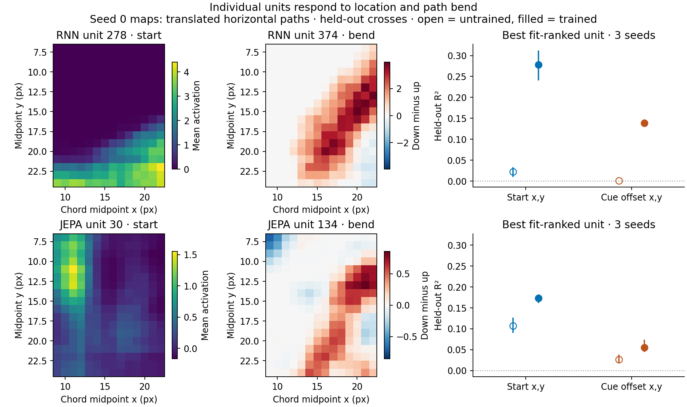
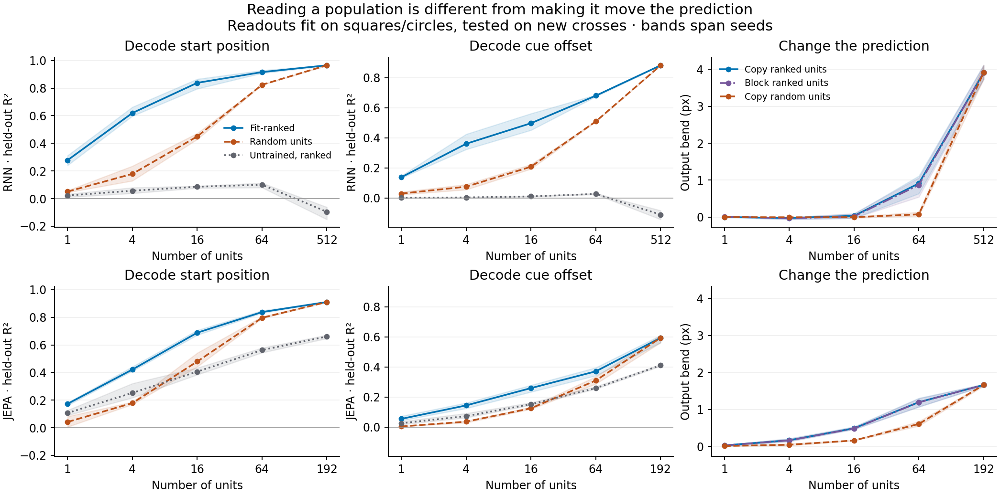
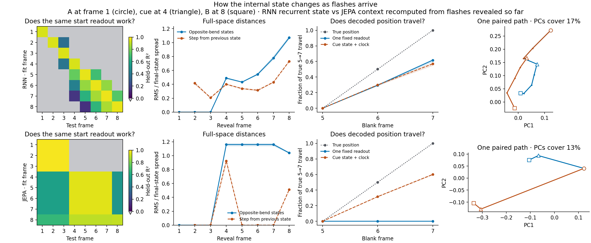

# What did the motion models learn?

**They learned a population code for where the object started and which way
the middle flash displaced it.** A single neuron often responds to a restricted
region of the display, but that is not the same as controlling the path. The
RNN state continues to change during blank frames; a time-independent readout
can extract motion from it, although an explicit clock plus memory of the cue
explains most of the projected travel as well.

## Experiment

Three seeds, each compared to its own initial weights with freshly fitted
readouts. Show A, a cue at frame 4, and B at frame 8. For each chord, render
two opposite constant-speed arcs with **identical endpoints and shape**.
Fit all rankings, affine readouts and PCA axes on 1,536 square/circle chords
(3,072 displays). Test on 512 different chords (1,024 displays) rendered as
crosses, an appearance not used in backbone training. No endpoint-centre pair
is repeated between these splits. No model weights are changed.

“Start” is the first flash's ink centroid. “Bend” for the decoders is a
2-D vector in screen coordinates: the cue's offset from the midpoint of
the two alternative cues. It is equal and opposite within each matched
pair, so endpoints cannot reveal it. Multivariate R² is one minus squared
prediction error divided by the held-out target variance (summed over x/y).
Zero is the test-mean predictor; negative means worse. Seed ranges are
descriptive, not confidence intervals over models.

## 1. Individual neurons



We test all 512 final recurrent units and all 192 **first context-layer GELU
neurons** of the JEPA. Rank each unit by how well its scalar activation alone
linearly predicts the two target coordinates on fitting movies. Report the
fit-selected winner on new movies, **not** the best score found on the test
set. The tuning maps translate a fixed horizontal path across the canvas:
the first map averages the two cue responses; the second subtracts the
upward-cue response from the downward-cue response at the same endpoints.

* RNN seed 0: unit 278 responds most when the path is low in the display.
  For unit 374, moving the cue downward boosts activity mainly along one
  diagonal band of positions, not everywhere a downward bend occurs.
* JEPA seed 0: unit 30 prefers a confined upper-left region on this grid;
  unit 134’s bend response also depends on where the path lies.

The start/bend winners explained **28% / 14%** of the held-out variance
for the RNN, **17% / 6%** for JEPA, averaging the fit-selected unit in each
seed. At initialization those pairs were **2% / <1%** and **11% / 3%**.
The numerical IDs label different physical units across seeds; a tuning map
is an example, not a universal position or bend neuron. The [unit-level
table](../results/motion_unit_scores.csv) includes both scores for every
unit, seed, target and checkpoint stage. Threshold counts are descriptive,
not tests of statistical significance.

## 2. Populations: readable does not mean causal



| Held-out variance explained | RNN start | RNN bend | JEPA start | JEPA bend |
|---|---:|---:|---:|---:|
| Best fit-ranked unit | 28% | 14% | 17% | 6% |
| 16 fit-ranked units | 84% | 50% | 69% | 26% |
| 16 randomly chosen units | 45% | 21% | 48% | 13% |
| Full population | 97% | 88% | 91% | 59% |
| Full population, untrained | −10% | −11% | 66% | 41% |

Each population size gets its own standardized ridge readout; no test labels
are used to rank units. Four random equal-sized sets per seed provide a
reference. Full-population probes with chord-shuffled training labels score
below zero in all trained model/target combinations on average. With the cue
omitted, the bend alternatives have identical inputs and are indistinguishable.
The untrained JEPA already has decodable spatial information: the trained
score alone is **not** the amount learned.

To test *use*, copy only the bend-ranked units from one arc into the matched
opposite-arc run and rerun the remaining layers. Reverse the swap to block
that subset alone. Score the change in the **model output**, not in the
trained probe: RNN ink centroid or JEPA predicted embedding calibrated on
individual fitting flashes, with endpoint drift subtracted as in the
[middle-cue experiment](../README.md#do-those-same-circuits-bend-a-path-when-only-its-middle-flash-moves).

| Units copied from opposite cue | RNN output bend | JEPA output bend |
|---|---:|---:|
| Best single bend-ranked unit | 0.004 px | 0.025 px |
| Top 16 | 0.036 px | 0.488 px |
| Top 64 | 0.913 px | 1.195 px |
| Random 64 (size-matched) | 0.076 px | 0.606 px |
| All units / intact model effect | 3.910 px | 1.661 px |

Thus 16 RNN neurons give a readout half the bend variance, but copying them
recovers **less than 1%** of the model’s mean bend. The readout can exploit a
signal the native decoder barely uses in isolation. Large groups move the
output more; these rankings do not establish a minimal causal set. The sizes
are different fractions of each model, and the checkpoints have different
training budgets.

## 3. What moves through latent space during the blanks?



For the RNN we record its actual recurrent state at every frame. The JEPA
does not run recurrently: at each reveal, we recompute its **final context**
using only flashes seen so far. This is distinct from its GELU neurons above
and from decoding its ordered predicted frame slots after the complete movie.

* **Memory is not a fixed readout.** Start position is readable from the trained
  RNN at every frame (same-time R² 0.94–0.97), but the frame-1 readout does
  not transfer intact to frame 8. Gray heatmap cells are negative held-out R².
  Changes in scale or mean as well as changes in coding direction can cause
  bad transfer; this alone does not establish a rotation.
* **The cue has a time course.** Opposite paths have the same state until the
  cue. In trained RNNs their RMS separation at the last blank is about 1.6×
  its value at the cue, despite an initial dip. At initialization it falls to
  about 0.20× instead. The JEPA’s separation stays constant until B arrives:
  the input and mask have not changed. Plotted distances are divided by the
  RMS spread of final states within that model and seed.
* **A fixed readout can extract travel.** Pool blank frames 5–7 to fit a
  single position readout without frame index or future endpoint. Apply it
  to the evolving states. Project the predicted 5→7 displacement onto the
  true displacement, summed across trials and normalized by summed true
  squared travel. A score of 100% matches *projected aggregate travel*, not
  necessarily each individual path.

| Position readout before the endpoint | RNN travel | RNN error | JEPA travel | JEPA error |
|---|---:|---:|---:|---:|
| One time-independent readout | 62% | 2.79 px | 0% | 3.14 px |
| Same analysis on untrained states | 34% | 5.65 px | 0% | 4.58 px |
| Trained state frozen at cue + separate readout for each blank | 57% | 2.95 px | 60% | 2.67 px |

The RNN dynamics carry useful motion information, but they are **not required
to explain most of this travel**: the last row gives the decoder time
explicitly and more readout parameters, without advancing the latent state
at all. The JEPA’s zero in the first row is architectural, not evidence that
its frame-specific predictions cannot interpolate. The PCA panels show the
first held-out pair, relative to its initial state, on axes fit to all
within-movie changes in the fitting set. The first two axes show only 17% of
the RNN and 13% of the JEPA fit variance for the illustrated seed; do not
infer the shape of the physical path from a two-dimensional latent plot.

### Reproduce

```bash
OPENBLAS_NUM_THREADS=2 uv run python scripts/profile_motion_units.py \
    --rnn checkpoints/apparent --jepa checkpoints/jepa
uv run python scripts/plot_motion_units.py
```

[Per-seed results, random and no-cue controls, cross-time matrices and map grids](../results/motion_unit_dynamics.json).
